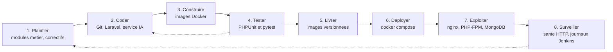
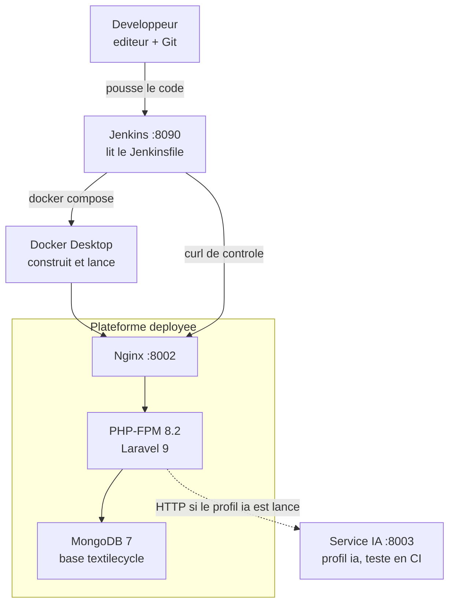
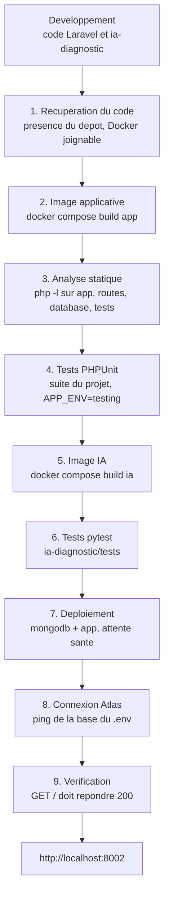

# DevOps — TexTileCycle

Chaîne **Docker + Jenkins** du projet : à chaque construction, le code est analysé, testé, empaqueté, puis la plateforme est mise en ligne.

Le développement quotidien (XAMPP, `php artisan serve` sur le port **8000**, service IA sur le port **8001**) n’est pas arrêté. La plateforme livrée par le pipeline écoute sur le port **8002**. Jenkins écoute sur le port **8090**.

| Service | Adresse | Identifiants |
|---|---|---|
| Application déployée | http://localhost:8002 | mêmes identifiants que le `.env` |
| Jenkins | http://localhost:8090 | admin / textilecycle |
| Base de données | MongoDB Atlas du `.env` | même cluster que le poste de développement |
| Service IA | http://127.0.0.1:8001 sur le poste | même jeton que le `.env` |

Le conteneur `app` charge le fichier `.env` (base Atlas, clé Gemini, WhatsApp, messagerie Gmail, clé d’application). Ce fichier reste hors de l’image. Trois réglages sont adaptés à Docker : l’adresse publique `http://localhost:8002`, l’appel au service IA du poste via `host.docker.internal:8001`, et le dossier `storage/app/public` du projet, monté tel quel pour que les chemins enregistrés en base (`vetements/…`, `guides-restyle/…`) ouvrent les mêmes photos que sur cette machine. Les tests PHPUnit du pipeline continuent d’utiliser le MongoDB local, pour ne pas écrire dans Atlas.

---

## 1. Processus DevOps

Huit activités, de l’idée jusqu’à l’exploitation. Les flèches du bas sont le retour d’information : un test rouge ou une page qui ne répond plus renvoie le travail au développement.



Ce que chaque activité change dans TexTileCycle :

| Activité | Où ça vit | Résultat |
|---|---|---|
| Planifier | `docs/ARCHITECTURE.md`, modules `app/Modules/` | Un périmètre (vêtements, ateliers, dons…) |
| Coder | dépôt Git local, monté dans Jenkins sur `/workspace` | Code PHP, Blade, Python |
| Construire | `docker/php/Dockerfile`, `ia-diagnostic/Dockerfile` | Images `textilecycle-app` et `textilecycle-ia` |
| Tester | `tests/`, `ia-diagnostic/tests/` | Suite PHPUnit et pytest, sans Atlas et sans modèles CLIP |
| Livrer | Docker Desktop (moteur local) | Images prêtes à lancer |
| Déployer | `docker-compose.yml`, étapes 7 et 8 du Jenkinsfile | Conteneurs `app` + `mongodb`, migrations, compte admin |
| Exploiter | Nginx et PHP-FPM dans le conteneur `app` | http://localhost:8002 |
| Surveiller | healthcheck Docker, étape 9, journaux Jenkins | HTTP 200 sur l’accueil, build vert ou rouge |

Vue des conteneurs une fois le pipeline passé :



Nginx et PHP-FPM sont dans **la même image** (`docker/php/Dockerfile`, Supervisord). Le site n’a pas besoin d’un volume partagé entre deux conteneurs : les fichiers de `public/` sont dans l’image. MongoDB est un conteneur séparé, avec un volume nommé pour garder les données entre deux redémarrages.

Le service IA n’est pas démarré par le déploiement par défaut : ses modèles CLIP pèsent environ 1,6 Go. Le pipeline **construit l’image et lance pytest** (faux moteur, aucun téléchargement). Pour le lancer ensuite : `docker compose --profile ia up -d ia`.

---

## 2. Pipeline, du développement au déploiement

Le fichier `Jenkinsfile` est le pipeline. Jenkins le charge au démarrage et lance le premier build. Neuf étapes, dans cet ordre : tant qu’une étape échoue, les suivantes ne partent pas.



Correspondance avec l’intégration continue et le déploiement continu :

| Étapes | Phase | Rôle |
|---|---|---|
| 1 à 6 | **CI** — intégration continue | Le code est récupéré, compilé en image, analysé et testé. Rien n’est publié si un test échoue. |
| 7 à 9 | **CD** — déploiement continu | Les conteneurs sont lancés, la base est préparée, la page d’accueil est contrôlée. |

Détail des étapes :

1. **Récupération du code.** Jenkins ne clone pas un dépôt distant : le projet est monté en lecture seule dans le conteneur Jenkins (`/workspace`). L’étape vérifie `artisan`, `composer.json`, `docker-compose.yml`, puis que le client Docker parle bien au moteur de Docker Desktop.
2. **Image applicative.** PHP 8.2, extension `mongodb`, Composer (dépendances de dev comprises, pour PHPUnit), Nginx, PHP-FPM. Le fichier `.env` est exclu de l’image (`.dockerignore`).
3. **Analyse statique.** `php -l` sur chaque fichier PHP de `app/`, `routes/`, `database/` et `tests/`. Une erreur de syntaxe arrête le pipeline.
4. **Tests PHPUnit.** Lancement dans l’image, avec `APP_ENV=testing`, cache et session en mémoire, mail en `array`. Les tests qui toucheraient MongoDB sont déjà isolés dans le projet (`BlocksRemoteMongo`) : le pipeline n’appelle pas Atlas.
5. **Image IA.** Python 3.11 et PyTorch **CPU** (pas de CUDA), puis les dépendances de `ia-diagnostic/requirements.txt` sauf le second `torch` qui tirerait une roue GPU.
6. **Tests pytest.** `pytest -q tests` dans l’image. Les tests remplacent le moteur CLIP par un faux moteur : aucun modèle n’est téléchargé (`HF_HUB_OFFLINE=1`).
7. **Déploiement.** `docker compose up -d --wait mongodb app`. Compose attend les healthchecks : MongoDB répond au ping, l’accueil HTTP répond.
8. **Connexion à Atlas.** `php artisan mongodb:ping` vérifie le cluster du `.env`. Le pipeline ne relance pas le seed sur cette base partagée.
9. **Vérification.** `curl` interne sur `http://127.0.0.1/`. Le code HTTP attendu est 200. Jenkins affiche alors le succès.

En cas d’échec, le journal de l’étape rouge dans Jenkins indique la commande et la sortie. Un correctif dans le code, puis « Lancer un build » sur le job `textilecycle-cicd`, rejoue toute la chaîne.

---

## 3. Fichiers

| Fichier | Rôle |
|---|---|
| `Jenkinsfile` | Les neuf étapes CI/CD |
| `docker-compose.yml` | MongoDB, application, Jenkins, service IA (profil `ia`) |
| `docker/php/Dockerfile` | Image Laravel : PHP-FPM 8.2, Nginx, Supervisord |
| `docker/php/nginx.conf` | Racine `public/`, passage à `index.php` |
| `docker/php/entrypoint.sh` | Dossiers `storage/`, droits, lien `public/storage` |
| `ia-diagnostic/Dockerfile` | Image du microservice de diagnostic |
| `docker/jenkins/Dockerfile` | Jenkins LTS + client Docker + plugin Pipeline |
| `devops/jenkins/init.groovy.d/01-job.groovy` | Compte admin, création du job, premier build |
| `.dockerignore` | Hors de l’image : `.env`, `vendor`, journaux, images uploadées |

---

## 4. Render

Le site public se décrit dans `render.yaml`. Render construit l’image `docker/php/Dockerfile`, écoute la variable `PORT`, et publie une adresse `https://….onrender.com`. L’adresse est recopiée dans `APP_URL` au démarrage. Les secrets (clé Laravel, URI Atlas, Gemini, WhatsApp, mot de passe Gmail, jeton IA) se saisissent dans le tableau de bord : ils ne sont pas dans le dépôt.

MongoDB Atlas doit autoriser les adresses de sortie de Render, documentées sur [les IP de sortie Render](https://render.com/docs/outbound-ip-addresses). Le service IA CLIP reste sur cette machine : une instance gratuite Render n’a pas assez de mémoire pour charger le modèle. Les photos de `storage/app/public` ne sont pas dans Git ; sur l’offre gratuite le disque est éphémère. Un disque persistant (offre payante) se monte sur `/var/www/html/storage/app/public`.

## 5. Relancer

Docker Desktop doit être démarré. Depuis la racine du projet :

```bash
docker compose up -d --build
```

Cela reconstruit l’application et Jenkins, puis les démarre avec MongoDB. Le job existe déjà : ouvrir http://localhost:8090, se connecter (`admin` / `textilecycle`), ouvrir **TexTileCycle — CI/CD**, puis **Lancer un build**.

Le service IA, en plus de l’application :

```bash
docker compose --profile ia up -d --build ia
```

Arrêter uniquement cette stack (les autres projets Docker ne sont pas touchés) :

```bash
docker compose down
```

`docker compose down -v` supprime aussi les volumes (base MongoDB du conteneur et historique Jenkins).
